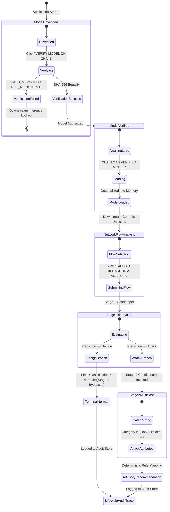

# Phase 7B.5.4 — Frontend Architecture Redesign Report: Interactive Architecture Demonstrator

**Project:** Blockchain-Based Provenance and Tamper-Evident Auditing for AI-Driven IoT Intrusion Detection  
**Repository:** `https://github.com/afrid995/blockchain-ai-iot-ids.git`  
**Authoritative Starting Checkpoint:** `beff27585a80f2b47a523ba390caa65966c4b6ce`  
**Date:** October 25, 2026  
**Document Version:** 1.0.0  

---

## 1. Executive Summary

Phase 7B.5.4 transforms the project web interface from an operational analytics dashboard into an **interactive architecture demonstrator**. While the previous user interface provided useful operational telemetry (threat meters, gauge charts, and tabular event lists), it obscured the core scientific contribution of the research: the sequential, fail-closed coupling of an Ethereum-based cryptographic provenance gate with a hierarchical machine learning pipeline and a deterministic advisory response recommendation engine.

The redesigned interface acts as a **guided visual state machine** executing the exact research pipeline:
$$\text{Model Selection} \longrightarrow \text{Cryptographic Verification} \longrightarrow \text{Authorized Model Loading} \longrightarrow \text{Network Flow Analysis} \longrightarrow \text{Stage 1 Binary IDS} \longrightarrow \text{Conditional Stage 2 Multiclass Classification} \longrightarrow \text{Advisory Response Recommendation} \longrightarrow \text{Audit Trail}$$

Every architectural boundary, conditional execution branch, and security invariant established in Phases 1 through 7B.5.3 is visually and interactively surfaced. Downstream inference stages remain disabled until upstream cryptographic verification and memory loading succeed. Benign flows visibly bypass Stage 2 to demonstrate the empirical 11.54% latency reduction, while attack flows conditionally trigger Stage 2 multiclass classification and generate structured, non-executable advisory recommendations.

---

## 2. Design Problem Analysis: Why an Operational Dashboard Was Inadequate

In a research evaluation or defense setting, evaluators assess whether the implemented system faithfully realizes the claimed architectural contributions:
1. **Opaque Multi-Stage Pipeline:** An operational dashboard presented a single output ("Attack: DoS") without exposing whether Stage 2 was invoked, how Stage 1 routed the flow, or why the latency differed between normal and attack traffic.
2. **Hidden Fail-Closed Mechanism:** The startup provenance verification gate between Ethereum EVM (`ModelRegistry.sol`) and local joblib artifacts was executed silently in the background. Observers could not witness how tampering or version mismatch halted the system prior to inference.
3. **Ambiguous Remediation Semantics:** Displaying recommendations inside operational alert banners often confused reviewers into assuming autonomous mitigation or firewall reconfiguration, violating the strict advisory-only research boundary.
4. **Unsubstantiated Blockchain Performance Invariants:** Without visible latency indicators and per-flow query counters, reviewers frequently assumed that each network flow incurred on-chain transaction delays, obscuring the critical distinction between control-plane provenance (startup) and data-plane inference (off-chain).

---

## 3. Architecture-First User Experience

The redesigned interface structure is partitioned into a primary **Architecture Demonstration Workflow** and four supporting specialized tabs:

```
┌────────────────────────────────────────────────────────────────────────────────────────┐
│                        MAIN NAVIGATION (Role & Context Selector)                       │
│  [🏛️ Architecture]   [⚡ Live Test]   [🛡️ Security Test]   [📊 Research Metrics]   [📜 Audit Log]  │
└────────────────────────────────────────────────────────────────────────────────────────┘
```

### 3.1 Primary Tab: Architecture Guided Execution Workflow

The Architecture tab organizes the end-to-end detection and response lifecycle into six sequential, numbered stage cards:

#### Stage 1: Model Trust & Integrity Gate
- **Interactive Model Selector:** Switch between **Stage 1 (Binary IDS - LightGBM)** and **Stage 2 (Attack Classifier - Random Forest)**.
- **Side-by-Side SHA-256 Digest Verification:**
  - Displays the local file SHA-256 computed over the on-disk joblib artifact (`ids_model.joblib` or `attack_classifier.joblib`).
  - Displays the on-chain registered SHA-256 retrieved via `ModelRegistry.sol::getModelVersion()`.
- **Two-Step Authorization Sequence:**
  - `VERIFY MODEL ON-CHAIN` triggers `POST /model/verify?target=stage1|stage2`, returning cryptographic equality status (`VERIFIED` or `HASH_MISMATCH`).
  - `LOAD VERIFIED MODEL` triggers `POST /model/load`, transitioning system state from verified to memory-loaded (`is_loaded = true`). Downstream inference remains locked until this authorization is complete.

#### Stage 2: Network Flow Analysis
- **Standardized UNSW-NB15 Flow Presets:** One-click preloads for authentic test flows:
  - `Normal` (legitimate HTTP connection, 0.12s, benign flags).
  - `DoS` (high packet rate TCP flood).
  - `Fuzzers` (malformed packet sequence).
  - `Exploits` (buffer overflow signature).
  - `Reconnaissance` (port sweep traffic pattern).
  - `Generic` (cryptographic collision / generic attack).
- **Human-Readable Flow Summary:** Presents high-level protocol (`tcp`), service (`http`), connection state (`FIN`), duration, packet counts, and byte volumes.
- **Inspect All 42 Features:** Expandable technical drawer displaying the exact 42 numerical/categorical UNSW-NB15 feature values.
- **Execute Hierarchical Analysis:** Invokes `POST /predict/hierarchical` with full telemetry.

#### Stage 3: Stage 1 — Binary Intrusion Detection (Gatekeeper)
- **Primary Determination:** Visually presents `Benign` vs `Attack` classification with model confidence score and stage-specific latency.
- **Dynamic Branching Decision Box:**
  - **Benign Flow:** Displays the green alert card `✓ BENIGN TRAFFIC PATH ENGAGED`, marking the final classification as `NORMAL`, declaring Stage 2 as `NOT INVOKED (Bypassed)`, and explaining that Stage 2 bypass saves ~11.54% runtime latency.
  - **Attack Flow:** Displays the amber alert card `⚠️ INTRUSION DETECTED — CONDITIONAL STAGE 2 TRIGGERED`, declaring Stage 1 determination as `ATTACK` and Stage 2 status as `CONDITIONALLY INVOKED`.

#### Stage 4: Stage 2 — Multiclass Attack Categorization
- **Conditional Visibility:** Active and populated only when Stage 1 detects an `Attack`.
- **Bypassed State Presentation:** When Stage 1 predicts `Benign`, Stage 4 is visibly styled in muted gray (`card-bypassed`) with the explicit banner:  
  *“Stage 2 Classification Was Not Invoked: Because Stage 1 classified the traffic as Benign, execution terminated early with label Normal. This conditional bypass avoids unnecessary multiclass inference on legitimate network traffic.”*
- **Invoked State Presentation:** Identifies the precise UNSW-NB15 attack category (e.g., `DoS`, `Fuzzers`, `Exploits`, `Reconnaissance`, `Generic`) with multiclass confidence score and attribution rationale.

#### Stage 5: Advisory Attack Response Recommendation
- **Non-Remediation Banner:** Prominently displays three regulatory and ethical badges:
  - `ADVISORY ONLY`
  - `HUMAN APPROVAL REQUIRED`
  - `AUTOMATED REMEDIATION DISABLED`
- **Advisory Playbook Structure:**
  - **Identified Threat:** Attack category and tactical priority (`CRITICAL`, `HIGH`, `MEDIUM`).
  - **Recommended Actions:** 3 ordered, technical, non-destructive diagnostic recommendations (e.g., upstream packet rate throttling, inspect web server access logs, rate-limit SYN packets).
  - **Tactical Rationale:** Research-grounded risk explanation.
  - **Known Limitations:** Contextual caveats (e.g., "Does not guarantee absence of distributed botnet participants").
- **Strict Boundary Guarantee:** The interface explicitly declares that no firewall rules, IP blocks, TCP resets, or host quarantines are executed.

#### Stage 6: Audit & Provenance Verification Trace
- **Cryptographic Event Trace:** Summarizes the prediction event ID (`evt-hier-...`), timestamp, Stage 1 model ID/version, Stage 2 model ID/version, total inference latency, and verified digest state.
- **Zero Blockchain Overhead Invariant:** Emphasizes `Per-Flow Registry Lookups: 0`, confirming that data-plane inference does not query the blockchain.

---

## 4. Sequential Security State Machine

To enforce research integrity, the frontend implements a strict, sequential state machine preventing out-of-order execution:



### State Machine Transition Rules:
1. **Rule 1 (Integrity Gate):** While model status is `UNVERIFIED` or `HASH_MISMATCH`, the `load-model-btn` is disabled.
2. **Rule 2 (Execution Lock):** While `isModelLoaded` is false, Stage 2 (`prediction-card`) displays the `flow-locked-placeholder` banner and `predict-btn` is disabled.
3. **Rule 3 (Conditional Routing):** If Stage 1 output is `Benign`, Stage 4 (`stage2-card`) enters `card-bypassed` mode, Stage 5 (`advisory-card`) is omitted, and the flow concludes as `Normal`.
4. **Rule 4 (Advisory Isolation):** Recommendations never provide an "Execute Action" button; all actions require external operator intervention.

---

## 5. Fail-Closed Security Demonstration Mode

The **Security Test** tab provides an interactive laboratory demonstrating the fail-closed security properties of the blockchain-backed integrity gate:

| Scenario ID | Test Scenario | Simulated Mutation | Expected Gate Response | Enforced Action | Downstream State |
|:---|:---|:---|:---:|:---:|:---:|
| `tampered_stage1` | Tampered Stage 1 (Binary IDS) | Byte mutation at byte offset 1024 of ephemeral Stage 1 artifact | `HASH_MISMATCH` | `MODEL_LOAD_BLOCKED` | `LOCKED` |
| `tampered_stage2` | Tampered Stage 2 (Multiclass) | Byte mutation at byte offset 2048 of ephemeral Stage 2 artifact | `HASH_MISMATCH` | `STAGE2_LOAD_BLOCKED` | `LOCKED` |
| `unregistered_version` | Unregistered Model Version | Query non-existent version string `v9.9.9` on-chain | `NOT_REGISTERED` | `MODEL_LOAD_BLOCKED` | `LOCKED` |
| `missing_artifact` | Missing Model Artifact | Point verification path to non-existent filename | `FILE_NOT_FOUND` | `MODEL_LOAD_BLOCKED` | `LOCKED` |
| `legitimate` | Legitimate Model Verification | Unaltered canonical weights evaluated against ModelRegistry.sol | `VERIFIED` | `AUTHORIZED_AND_LOADED` | `UNLOCKED` |

### Methodological Rigor: Ephemeral Mutation
All security simulations execute in ephemeral memory copies on the backend via `POST /security/test-scenario`. The canonical model files on disk (`ml/artifacts/ids_model.joblib` and `ml/artifacts/attack_classifier.joblib`) are **never modified**, ensuring 100% preservation of experimental weights and checksums.

---

## 6. Evaluator Q&A Reference Guide

Embedded directly at the base of the Architecture tab is an **Evaluator Q&A Reference Guide** providing authoritative answers to the nine core questions typically raised during project evaluation:

1. **Why does this system use blockchain?**  
   *Answer:* The blockchain provides an immutable, decentralized control-plane registry for model provenance and a tamper-evident audit log. It establishes cryptographic proof of which authorized model produced an alert without relying on trusting a central server.
2. **Is the blockchain queried for every incoming network flow?**  
   *Answer:* No. The evaluated per-flow inference path performs **zero blockchain registry lookups**. All blockchain queries occur strictly at application startup / pre-load gating, preserving sub-50ms inference speeds.
3. **What is the difference between Stage 1 and Stage 2?**  
   *Answer:* Stage 1 is a rapid binary gatekeeper (LightGBM) optimized for high-precision Benign vs Attack triage. Stage 2 is a specialized multiclass classifier (Random Forest) invoked only when Stage 1 detects an intrusion to attribute specific attack categories.
4. **What happens after cryptographic verification succeeds?**  
   *Answer:* The verified model is authorized for memory loading. The server deserializes the model pipeline and unlocks downstream network flow inference.
5. **What happens if Stage 1 classifies a flow as Benign?**  
   *Answer:* The final result is designated as "Normal" and Stage 2 is completely bypassed. Bypassing Stage 2 reduces mean inference latency by an empirical 11.54% on benign traffic.
6. **What happens if Stage 1 classifies a flow as Attack?**  
   *Answer:* The flow is conditionally routed to Stage 2, which performs multiclass classification across 9 UNSW-NB15 attack categories (DoS, Exploits, Generic, Reconnaissance, etc.).
7. **What happens next after Stage 2 classification?**  
   *Answer:* The system maps the identified category to a deterministic, human-in-the-loop Advisory Attack Response Recommendation with tactical priorities, operator guidance, and risk rationales.
8. **Does the system automatically block the attacker or modify firewall rules?**  
   *Answer:* No. Autonomous remediation is strictly disabled (`is_advisory = true`, `requires_human_approval = true`, `automated_remediation_enabled = false`). The recommendations guide human security operators.
9. **What are the limitations of the advisory recommendations?**  
   *Answer:* Recommendations are rule-based, deterministic heuristics. They do not guarantee attack prevention, do not execute automated mitigation, and rely on human judgment to validate context before executing operational changes.

---

## 7. Supporting Demonstration Tabs

### 7.1 Tab 2: Live Test (Operator Workbench)
- Allows security operators to submit arbitrary 42-feature vectors or select presets.
- Provides a direct comparison toggle between `POST /predict/hierarchical` (full 2-stage hierarchical pipeline) and `POST /predict` (legacy single-stage binary baseline).
- Displays raw JSON responses for technical validation.

### 7.2 Tab 3: Security Test (Fail-Closed Demonstrator)
- Full interactive harness for executing the 5 security test scenarios described in Section 5.
- Real-time step-by-step visual animation tracing the fail-closed sequence.

### 7.3 Tab 4: Research Metrics (Empirical Performance)
- Displays Phase 5B operational analytics (threat distribution, confidence levels, latency profiling).
- Displays Phase 7B empirical baseline statistics:
  - Stage 1 Binary Accuracy (98.67%) and Precision (98.78%).
  - Stage 2 Multiclass Macro F1-Score (67.66%) and Weighted F1-Score (77.94%).
  - Empirical Latency Delta: Benign flows (16.27 ms) vs Attack flows (18.39 ms) yielding 11.54% bypass savings.
  - Transparent disclosure of hierarchical cascade error propagation (3 false negatives on 10,000 UNSW-NB15 test flows).

### 7.4 Tab 5: Audit Log (Tamper-Evident History)
- Paginated table of historical inference and security events.
- Filterable by event type: `ALL`, `PREDICTION`, `VERIFICATION`, `SECURITY_ALERT`, `MODEL_LOAD_BLOCKED`.
- Verifies that raw 42-feature vectors are omitted to avoid telemetry bloat and privacy leakage.

---

## 8. Verification and Test Results

### 8.1 Frontend Test Suite
A dedicated Vitest test suite (`frontend/src/test/architecture_workflow.test.jsx`) was executed alongside existing test suites:

```text
✓ src/test/analytics.test.js (16 tests)
✓ src/test/App.test.jsx (10 tests)
✓ src/test/architecture_workflow.test.jsx (20 tests)

Test Files  3 passed (3)
     Tests  46 passed (46)
  Duration  3.24s
```

All 20 Phase 7B.5.4 requirements were programmatically validated:
1. `Initial state renders Model Trust & Integrity Gate as primary screen` (PASSED)
2. `Network Flow stage shows locked state when model is unverified/unloaded` (PASSED)
3. `Model verification success authorizes model loading` (PASSED)
4. `Model verification failure keeps downstream stages locked (fail-closed)` (PASSED)
5. `Successful model loading unlocks network-flow analysis` (PASSED)
6. `Benign prediction produces Normal and does not invoke Stage 2` (PASSED)
7. `Attack prediction invokes Stage 2 conditionally` (PASSED)
8. `Attack prediction displays advisory response recommendations` (PASSED)
9. `Benign prediction does NOT display advisory response recommendations` (PASSED)
10. `Displays prominent "ADVISORY ONLY" badge` (PASSED)
11. `Displays prominent "HUMAN APPROVAL REQUIRED" badge` (PASSED)
12. `Displays prominent "AUTOMATED REMEDIATION DISABLED" badge` (PASSED)
13. `Tampered Stage 1 security scenario triggers fail-closed block` (PASSED)
14. `Tampered Stage 2 security scenario blocks Stage 2 fail-closed` (PASSED)
15. `Existing /predict legacy endpoint compatibility remains functional` (PASSED)
16. `/model/status endpoint response contract preserved` (PASSED)
17. `Evaluator Q&A Reference Guide renders all 9 research questions` (PASSED)
18. `Frontend does not persist raw 42-feature vectors in audit records` (PASSED)
19. `Frontend communicates strictly via REST API (no direct Web3 RPC)` (PASSED)
20. `Research Metrics and Audit sections remain fully accessible via navigation tabs` (PASSED)

### 8.2 Production Build Verification
The production build was verified using Vite:
```text
vite v6.4.5 building for production...
✓ 40 modules transformed.
dist/index.html                   0.63 kB │ gzip:  0.43 kB
dist/assets/index-C3mdwBZo.css   30.87 kB │ gzip:  5.55 kB
dist/assets/index-D9X5A4yc.js   229.54 kB │ gzip: 66.91 kB
✓ built in 611ms
```

---

## 9. Conclusion

The Phase 7B.5.4 frontend redesign successfully converts the project interface into an architecture demonstrator. Evaluators, advisors, and defense committees can now visually trace and interactively verify each component of the research contribution—from smart contract cryptographic provenance verification to fail-closed containment, hierarchical inference routing, and non-remediating advisory response guidance.
