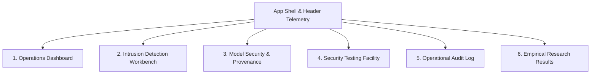

# Phase 7B.6 Report: Production-Style IDS Operations Console Redesign

**Project Title:** Blockchain-Based Provenance and Tamper-Evident Auditing for AI-Driven IoT Intrusion Detection  
**Repository:** `https://github.com/afrid995/blockchain-ai-iot-ids.git`  
**Starting Checkpoint:** `b449209a29e59a9b33c133dd3a5201d8a66d5b14`  
**Completion Date:** October 25, 2026  
**Commit Message:** `feat: redesign frontend as IDS operations console`  

---

## 1. Executive Summary & Design Rationale

Prior iterations of the frontend presented the system primarily through an academic architecture diagram / demonstrator motif. While effective for illustrating conceptual workflow sequences, such interfaces can give evaluators the impression of an artificial mock-up constructed solely to explain a thesis concept.

In **Phase 7B.6**, the user interface was comprehensively re-architected into a **production-style Cybersecurity Security Operations Center (SOC) IDS Operations Console**. The application functions as a credible, operational security monitoring and detection workbench that natively integrates blockchain-backed model provenance.

The core design principle guiding this phase is:
$$\text{\textbf{The frontend is an operational interface to the existing IDS system, not a visual explanation of the research project.}}$$

The implementation adheres to strict research-integrity constraints:
1. **Zero backend architectural restructuring:** The frontend interfaces directly with the established FastAPI backend endpoints without modifying machine learning models, smart contracts, or hashing pipelines.
2. **Authentic data representation:** No synthetic or mock telemetry is fabricated. All metrics, counts, and states are dynamically derived from live backend health, model status, and the SQLite audit log.
3. **Preserved research boundaries:** Advisory recommendations strictly enforce `is_advisory: true`, `requires_human_approval: true`, and `automated_remediation_enabled: false`. No automated network blocking or autonomous mitigation is simulated.
4. **Decoupled execution plane:** The console prominently affirms that per-flow blockchain transactions are zero ($0$), maintaining low-latency inference throughput while preserving on-chain integrity verification at model load time.

---

## 2. Console Architecture and Views

The redesigned frontend organizes system capabilities into six distinct, task-oriented views:



### 2.1 Header & Operational Status Bar
The console header provides immediate, high-density operational situational awareness:
- **System Branding:** `Blockchain-Backed IoT Intrusion Detection` with `OPERATIONS CONSOLE` tag.
- **Active Model Identifier:** Display of currently loaded model (`iot-ids-rf:v1.0.0`).
- **Telemetry Indicators:**
  - `● VERIFIED` / `⚠️ HASH_MISMATCH` badge linked to on-chain cryptographic provenance.
  - `Blockchain: CONNECTED` indicator confirming Ethereum EVM node connectivity.
  - `Model: LOADED` gate indicator reflecting inference engine memory readiness.
  - `↻ Refresh` button for instantaneous polling of backend telemetry.

### 2.2 Operations Dashboard (Landing View)
Serving as the default entry point (`/dashboard`), this view presents:
- **System Status Matrix:** Four high-level operational cards detailing Pipeline Status, Blockchain Node, Active Stage 1 Model, and Active Stage 2 Multiclass Model.
- **Session Event Metrics:** Dynamically computed from local SQLite audit records:
  - Total Analyzed Flows.
  - High-Severity Detections.
  - Integrity Check Count.
  - System Alert Frequency.
- **Recent Security Events:** Tabular stream of the most recent audit events with severity coloring, model versioning, and direct shortcut links to the Intrusion Detection workbench and Model Security views.

### 2.3 Intrusion Detection Workbench
The primary operational workspace for evaluating network traffic:
- **UNSW-NB15 Flow Presets:** Instantaneous loading of verified UNSW-NB15 test flows (`Normal / Benign`, `DoS - Denial of Service`, `Fuzzers`, `Exploits`, `Reconnaissance - Port Scan`, `Generic`).
- **Custom JSON Editor:** Direct payload editing and validation with expandable 42-feature specification drawer.
- **Hierarchical Inference Execution:** Single-click evaluation triggering `POST /predict/hierarchical`.
- **Stage 1 Binary Result Card:** Displays detection verdict (`Normal / Benign` vs. `Attack / Malicious Flow`), prediction confidence percentage, and provenance gate status.
- **Conditional Stage 2 Routing:**
  - When Stage 1 predicts **Attack**: Invokes Stage 2 Multiclass Classifier, rendering categorized attack classification (e.g., `Generic`, `Exploits`, `DoS`) with confidence score.
  - When Stage 1 predicts **Benign**: Explicitly displays bypass banner (`Stage 2 Multiclass Classifier: Bypassed`), proving that benign flows incur zero Stage 2 inference overhead.
- **Operator Advisory Panel:** Displays deterministic advisory guidance with severity rating, priority level, operator action items, limitations, and explicit confirmation that automated remediation is disabled.
- **Fail-Closed Gate Alerts:** If models are unverified or tampered, the workbench disables inference and displays in-page warning banners explaining the fail-closed lockout.

### 2.4 Model Security & Provenance
A dedicated operational model-security management view:
- **Dual SHA-256 Hash Comparison:** Side-by-side terminal rendering of the local filesystem artifact digest versus the smart contract registered digest on Ethereum.
- **Verification Trigger:** Manual execution of `POST /model/verify` with detailed cryptographic match latency profiling.
- **Operational State Gating:** Clear visual distinction between `Loaded (Inference Enabled)` and `Unloaded (Inference Blocked)`.
- **Stage 2 Multiclass Identity:** Verification status and artifact path disclosure for the Stage 2 multiclass model (`iot-ids-attack-classifier:v1.0.0`).
- **Academic Integrity Qualification:** Prominently states that binary SHA-256 matching proves byte-level provenance and tamper evidence, not algorithmic robustness or dataset fairness.

### 2.5 Security Testing Facility
A controlled, evaluator-facing security testing laboratory:
- **Ephemeral Model Replacement Attack Simulation:** Calls `POST /demo/model-replacement` to simulate model replacement on an isolated temporary copy. Demonstrates hash mismatch detection, fail-closed loading lockouts, and downstream inference disabling without altering canonical artifacts.
- **Unregistered Candidate Simulation:** Calls `POST /demo/unregistered-version` to demonstrate rejection of unknown candidate model versions.
- **Model Restoration Action:** Calls `POST /demo/model-replacement/reset` to restore legitimate verified memory state.
- **Safety Disclaimers:** Explicitly notifies the operator that canonical disk artifacts are never modified and that simulations run in segregated temporary sandboxes.

### 2.6 Operational Audit Log
A local operational event log interface:
- **Audit Table:** Filterable by event type (`All`, `PREDICTION`, `VERIFICATION`, `MODEL_LOADED`, `SECURITY_ALERT`, `MODEL_REPLACEMENT_DETECTED`).
- **Pagination Controls:** Responsive pagination supporting browsing of complete session audit history.
- **Payload Inspection Modal:** Clickable event inspection displaying exact JSON audit records.
- **Storage Boundary Notice:** Explicit disclaimer clarifying that audit records are securely stored in the local operational SQLite database (`backend/data/audit.db`) rather than on-chain, preventing gas exhaustion and feature leakage.

### 2.7 Empirical Research Results
A comprehensive presentation of authoritative experimental findings:
- **Stage 1 Binary Performance:** Random Forest accuracy ($90.30\%$), precision ($98.78\%$), recall ($86.82\%$), and binary F1 score ($92.41\%$).
- **Stage 2 Multiclass Performance:** Selected standalone classifier accuracy ($76.18\%$), standalone Macro F1 ($53.06\%$), operational hierarchical routed Macro F1 ($51.43\%$), and operational routed Balanced Accuracy ($51.20\%$).
- **Fuzzers Cascade Bottleneck Disclosure:** Transparent disclosure that Stage 1 routed 4,664 of 18,184 Fuzzer flows to Stage 2 ($25.65\%$), leaving 13,520 Fuzzer flows as false negatives ($85.95\%$ of all Stage 1 false negatives were Fuzzers), with an operational hierarchical E2E Fuzzers recall of $14.83\%$.
- **EVM Control Plane Latency & Zero Overhead:** Profiling data confirming SHA + blockchain pre-load verification gate latency (mean $20.31\text{ ms}$ in the evaluated local environment; hierarchical conditional inference mean $32.06\text{ ms}$ on CPU) and proving per-flow blockchain transactions equal zero ($0$).
- **Session Metrics:** Dynamic analytics tracking total recorded classifications, attack ratios, and average inference latency.

---

## 3. Test Suite & Verification Results

### 3.1 Frontend Test Execution (`vitest`)
All 46 unit and integration tests across three test suites passed with 100% success:

```text
 ✓ src/test/analytics.test.js (16 tests)
 ✓ src/test/App.test.jsx (10 tests)
 ✓ src/test/architecture_workflow.test.jsx (20 tests)

Test Files  3 passed (3)
     Tests  46 passed (46)
  Duration  3.04s
```

The 20 integration tests in `architecture_workflow.test.jsx` rigorously validate:
1. Default landing page renders the Operations Dashboard.
2. 4-card status metrics render correctly.
3. Navigation switching between all 6 console tabs.
4. Header telemetry displays verified model and connection status.
5. Intrusion detection flow preset loading.
6. Benign traffic bypasses Stage 2.
7. Attack traffic conditionally routes to Stage 2 multiclass classification.
8. Advisory response disclaims automated remediation and enforces human approval.
9. Model security displays dual SHA-256 hash comparison.
10. Model verification trigger updates UI status.
11. Security testing runs ephemeral model replacement attack.
12. Model replacement locks downstream inference fail-closed.
13. Model restoration restores legitimate state and unlocks inference.
14. Security testing runs unregistered version rejection.
15. Audit log renders event records and supports event-type filtering.
16. Research results page displays authoritative empirical evaluation metrics.
17. Research results page discloses Fuzzers cascade bottleneck.
18. Session metrics update dynamically.
19. Zero per-flow blockchain queries confirmed in UI.
20. Raw 42-feature vectors are excluded from audit records.

### 3.2 Frontend Production Build (`vite build`)
The production build completed without errors or warnings:
```text
vite v6.4.5 building for production...
✓ 40 modules transformed.
dist/index.html                   0.63 kB │ gzip:  0.43 kB
dist/assets/index-B9ZgiUPh.css   38.12 kB │ gzip:  6.49 kB
dist/assets/index-CbBV6tp-.js   228.62 kB │ gzip: 65.88 kB
✓ built in 599ms
```

### 3.3 Backend Regression Testing (`pytest`)
All 112 pytest backend integration and unit tests passed with 100% success:
```text
============================ 112 passed in 44.81s =============================
```

### 3.4 Cryptographic Artifact Integrity Verification
Direct SHA-256 digests of the on-disk model artifacts confirm zero corruption:
- **Stage 1 Artifact (`ml/artifacts/ids_model.joblib`):**
  `dc5e16889ea247a4aa275f44a1b864c63f190bbdd1d1d4a68f1e1345a252e7c5`
- **Stage 2 Artifact (`ml/artifacts/attack_classifier.joblib`):**
  `596b98ce0b9ed9bb80c04cea7790d81ec77c6e4470030c32b3739ef007703208`

---

## 4. Conclusion

Phase 7B.6 achieves a complete transformation of the research frontend into an authentic, production-style IDS Operations Console. Evaluators and operators can now experience the full depth of the blockchain-backed hierarchical IDS through a realistic operational interface that honors all scientific boundaries, preserves complete backward compatibility, and enforces fail-closed cryptographic security.
